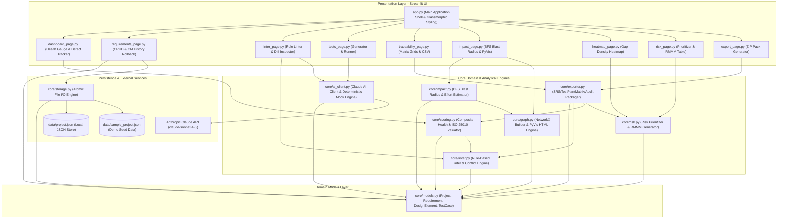

# TraceLens System Architecture & Component Diagram

This document illustrates the layered architectural model, component boundaries, and data flows of TraceLens.

## Mermaid Architecture & Component Diagram

## Architectural Highlights

1. **Strict Layered Separation**: The presentation layer (Streamlit pages) depends exclusively on the domain services and domain models. The domain layer has zero dependency on UI frameworks.
2. **Deterministic Offline Resilience**: `core/ai_client.py` sits behind an abstract facade that queries Anthropic Claude when API credentials are provided, but falls back instantaneously to deterministic rule-based mock logic if offline or if an API failure occurs.
3. **Atomic File Persistence**: `core/storage.py` writes to a `.tmp` file and executes an atomic `os.replace` to prevent file corruption during demos or concurrent reads.
