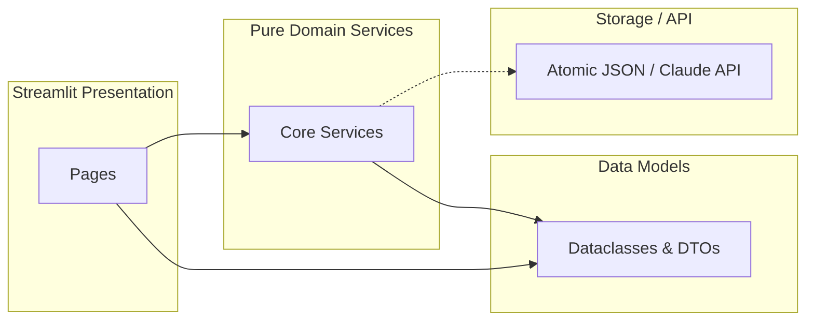

# TraceLens Architectural Design Rationale

This document presents the software engineering principles, structural decisions, and architectural trade-offs applied in designing and building **TraceLens**.

---

## 1. Core Architectural Goals

The architecture of TraceLens is guided by three core software engineering principles:
1. **High Cohesion:** Each module encapsulated within `core/` focuses on one single, distinct algorithmic or domain responsibility.
2. **Low Coupling:** Subsystems communicate exclusively through well-defined data classes and pure functions, eliminating hidden side effects and state entanglement.
3. **Graceful Fault Tolerance:** External dependencies (such as cloud LLM APIs) are isolated behind fault-tolerant adapter boundaries with deterministic fallback engines.

---

## 2. Modularity & Package Organization

The codebase is organized into four strictly segregated tiers:

```
tracelens/
  ├── core/               # Pure algorithmic domain logic (No Streamlit UI dependencies)
  ├── pages/              # View components rendering specific pages
  ├── data/               # Persistent JSON project state and demo seed data
  ├── tests/              # Autonomous Pytest test suites (35 tests, 85%+ coverage)
  ├── docs/               # System architecture and SE specifications with Mermaid models
  └── app.py              # Application bootstrap, navigation shell, and theme injector
```

### Decoupling Domain Logic from UI
A critical design decision in TraceLens is that **none of the modules in `core/` import or depend on Streamlit (`st`)**.
- `core/linter.py` takes a `Requirement` object and returns a `RequirementLintResult` dataclass.
- `core/impact.py` takes a `Project` and a string ID and returns an `ImpactAnalysisResult`.
- `core/scoring.py` takes a `Project` and returns a `QualityHealthReport`.

**Benefits:**
- **100% Testability:** Core algorithms can be verified in milliseconds under automated testing without spawning headless browsers or mock web sessions.
- **Portability:** If the UI framework is swapped to FastAPI, Next.js, or a CLI tool, zero lines of domain code need to be rewritten.

---

## 3. High Cohesion in Subsystems

| Module | Single Responsibility | Cohesion Justification |
|:-------|:----------------------|:-----------------------|
| `core/models.py` | State definitions & invariants | Encapsulates dataclasses (`Requirement`, `DesignElement`, `TestCase`, `Project`) and their serialization without business rules. |
| `core/storage.py` | Atomic persistence | Manages safe file I/O staging and fallback recovery, shielding domain logic from file system mechanics. |
| `core/linter.py` | Quality rule evaluation | Evaluates syntax, measurability, and semantic conflicts against IEEE/INCOSE criteria. |
| `core/graph.py` | Graph synthesis & PyVis layout | Translates project models into NetworkX graphs and interactive PyVis visual embeddings. |
| `core/impact.py` | Blast radius BFS traversal | Traverses traceability networks and estimates rework hours; does not handle UI rendering. |
| `core/risk.py` | Risk formulas & RMMM | Computes $R = I \times C \times (1 + \text{changes})$ and generates risk mitigation records. |
| `core/scoring.py` | Health score & ISO 25010 | Computes the 4-factor composite scorecard and maps metrics to standard software quality attributes. |
| `core/ai_client.py` | LLM communication & fallback | Manages Anthropic API calls, JSON response sanitization, and deterministic mock templates. |
| `core/exporter.py` | Artifact compilation & packaging | Transforms in-memory models into IEEE 830 SRS, IEEE 829 Test Plans, CSV matrices, and ZIP archives. |

---

## 4. Low Coupling & Dependency Inversion



1. **Immutable Snapshots for Versioning:** Changes to requirements create new `RequirementHistoryEntry` records rather than mutating in-place historical records.
2. **Decoupled Linkage Representation:** Test cases and design elements reference requirements by string IDs (`linked_req = "R1"`), avoiding circular pointer cycles and simplifying JSON serialization.
3. **Facade Pattern for AI:** The AI client encapsulates external HTTP requests. If the Anthropic API is unreachable, times out, or lacks credentials, the caller receives the exact same typed response structure from the deterministic mock engine with zero crashes.

---

## 5. Reliability & Atomic File Persistence

Traditional JSON file writes can leave files in a truncated or corrupt state if the process is terminated mid-write. TraceLens implements **atomic file staging**:
```python
# Write to temp file first
with open(temp_path, "w", encoding="utf-8") as f:
    json.dump(payload, f, indent=2)

# Atomic replace at the filesystem level
os.replace(temp_path, target_path)
```
This guarantees that during demonstrations, sudden reloads or multi-tab usage never corrupt the persistent project state.
