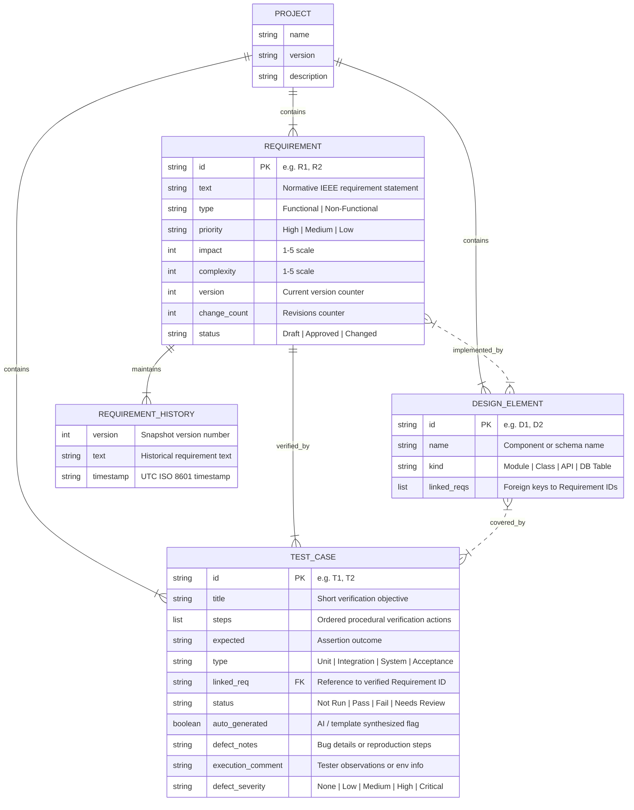

# TraceLens Data Architecture Entity-Relationship Diagram (ERD)

This document visualizes the entities, properties, and relationships stored within the local TraceLens JSON data model (`project.json`).

## Traceability Invariants

1. **Requirement Integrity:** Each requirement maintains an append-only `history` list of immutable version snapshots.
2. **Design Bidirectionality:** Design elements reference requirements via `linked_reqs`; the traceability engine projects bidirectional edges into the NetworkX graph.
3. **Verification Linkage:** Every test case specifies `linked_req` referencing exactly one requirement. Orphaned tests (`linked_req = ""`) are highlighted during quality audits.
4. **Defect Tracking:** Tests in `Fail` status record severity and actionable defect notes directly on the test entity.
