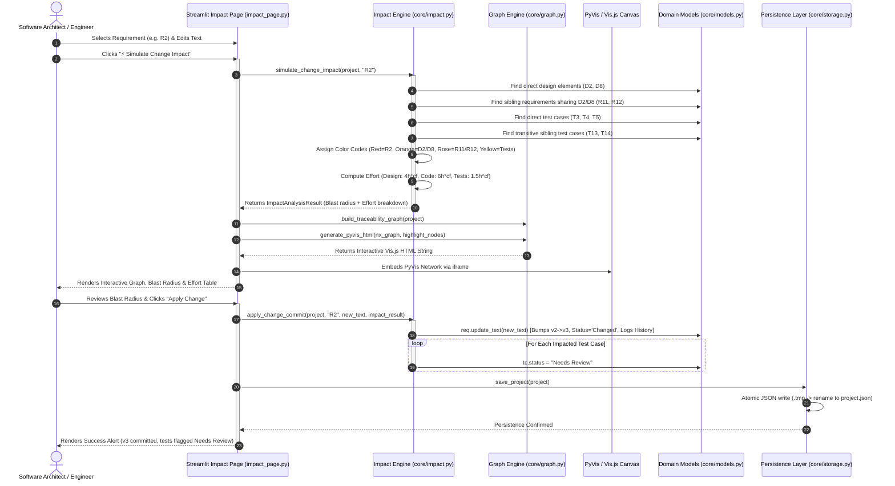

# TraceLens Sequence Diagram: Change Impact Simulation

This document outlines the detailed sequence of interactions during a Change Impact Simulation and commit lifecycle.

## Mermaid Sequence Diagram

