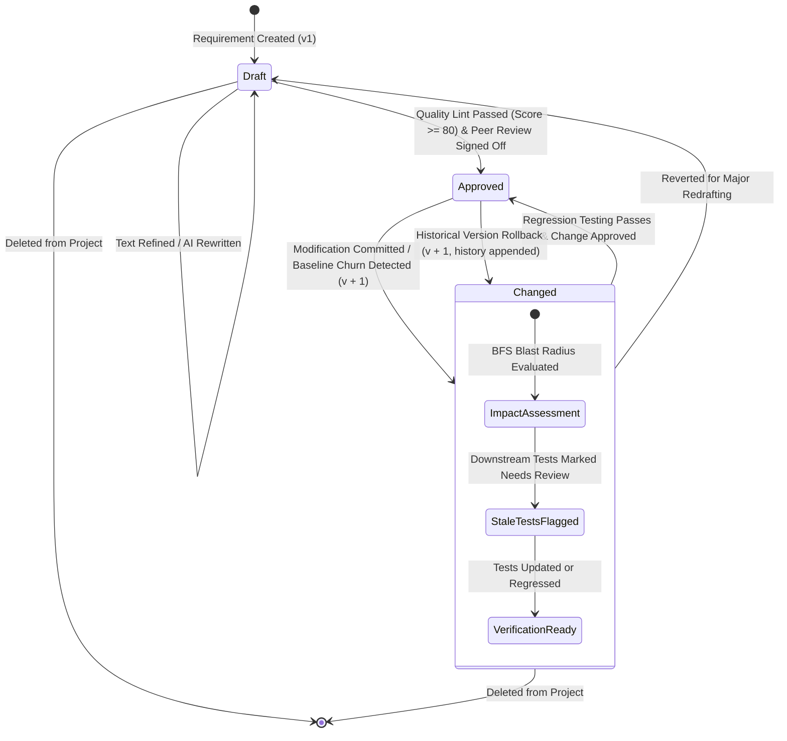

# TraceLens Requirement Configuration Management (CM) State Machine

This document models the lifecycle states and transitions of a software requirement artifact within TraceLens.

## Lifecycle States Explanation

| State | Description | Permitted Actions |
|---|---|---|
| **Draft** | Initial authored requirement statement. Not yet formally approved or tested. | Edit text, run AI rewrite, run quality linter, delete. |
| **Approved** | Baselined requirement that has passed quality linting and is linked to architecture and verification tests. | Link design elements, link test cases, trigger impact simulation. |
| **Changed** | Modified requirement whose previous baseline was changed. Triggers blast-radius analysis across connected design elements and test cases. | Run BFS impact simulation, review test regressions, rollback to prior version, re-approve. |
