# TraceLens Use Case Model

This document specifies the primary operational actors and use cases for the TraceLens Requirements Engineering and Traceability system.

## Mermaid Use Case Diagram

```mermaid
graph TD
    %% Actors
    ActorRE["Requirements Engineer"]
    ActorQA["QA / Test Engineer"]
    ActorSA["Software Architect"]
    ActorPM["Project Manager / Lead"]

    %% Requirements Management
    subgraph UC_Req [Requirements & Quality Management]
        UC1(["Manage Requirements Baseline (CRUD & CM)"])
        UC2(["Inspect Quality via Rule-Based Linter"])
        UC3(["Refactor Ambiguity via AI / Template Rewrite"])
        UC4(["Detect Semantic Contradictions & Conflicts"])
        UC5(["Rollback to Historical Requirement Version"])
    end

    %% Change Impact & Traceability
    subgraph UC_Impact [Traceability & Impact Simulation]
        UC6(["Simulate Change Impact via Graph BFS"])
        UC7(["Estimate Engineering Rework Hours"])
        UC8(["Propagate Changes & Flag Tests for Review"])
        UC9(["Inspect Bi-Directional Traceability Matrix"])
    end

    %% Verification & Risk
    subgraph UC_Verif [Verification & Risk Prioritization]
        UC10(["Synthesize Test Cases via AI/Mock"])
        UC11(["Track Test Execution Status (Pass/Fail)"])
        UC12(["Inspect Test Gap Density Heatmap"])
        UC13(["Prioritize Tests by Risk Score"])
        UC14(["Generate Top-5 RMMM Strategy Table"])
        UC15(["Export IEEE Documentation Pack (ZIP)"])
    end

    %% Actor to Use Case Associations
    ActorRE --> UC1
    ActorRE --> UC2
    ActorRE --> UC3
    ActorRE --> UC4
    ActorRE --> UC5
    ActorRE --> UC6
    ActorRE --> UC8

    ActorSA --> UC6
    ActorSA --> UC7
    ActorSA --> UC9
    ActorSA --> UC14

    ActorQA --> UC9
    ActorQA --> UC10
    ActorQA --> UC11
    ActorQA --> UC12
    ActorQA --> UC13

    ActorPM --> UC7
    ActorPM --> UC13
    ActorPM --> UC14
    ActorPM --> UC15
```

## Actor Descriptions

| Actor | Responsibilities | Key System Touchpoints |
|:------|:-----------------|:-----------------------|
| **Requirements Engineer** | Elicits, refines, and baselines software requirements; resolves ambiguities using the linter and AI rewriter. | Requirements Catalog, Quality Linter, Conflict Detector, Version History |
| **Software Architect** | Evaluates architectural blast radius, reviews component linkages, and plans rework effort before committing baseline changes. | Change Impact Simulator, PyVis Interactive Network, Design Linkage Grid |
| **QA / Test Engineer** | Generates comprehensive test suites, identifies uncovered requirements using the gap heatmap, and logs execution outcomes. | Test Generator, Gap Heatmap, Test Run Tracker, Defect Watchlist |
| **Project Manager** | Monitors overall Quality Health Score, verifies ISO 25010 compliance, audits RMMM risks, and exports certified SRS/Test Plan packs. | Executive Dashboard, Risk Prioritizer, RMMM Table, Export Pack |
